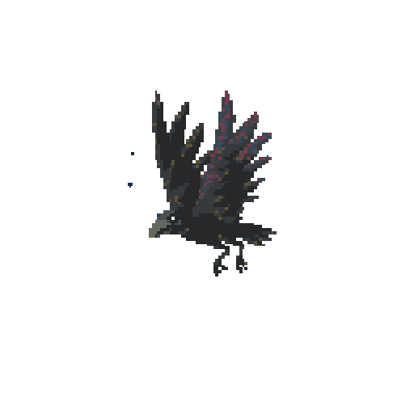

# Git Raven
<div align="center">
  <a href="https://github.com/Rodgerss111?tab=repositories">
    <picture>
      
    </picture>
  </a>
</div>
Git Raven is a Rust command-line project that turns a GitHub account's public
activity into a pixel-art animal animation. It collects an account snapshot and
renders a GIF, PNG, and browser preview based on the account's activity.

## Usage

The project requires Rust and an authenticated
[GitHub CLI](https://cli.github.com/) installation.

```sh
cargo run -- collect USERNAME --output snapshot.json
cargo run -- render snapshot.json --output-dir output
```

The renderer supports these body styles:

```text
white, black, asagi, tea, gold, platinum
```

For example:

```sh
cargo run -- render snapshot.json --output-dir output --body black
```

Generated files include:

- `koi.gif` - a looping animation
- `koi.png` - a still image
- `preview.html` - a light and dark background preview

## Inspiration and Creative Direction

This repository is a reference to **Anthony Yalong**'s original project. I
modified and refined the idea in my own way to create a new animal that is
different from the original koi: a raven.

I chose the raven because it represents my creativity in everything I do. To
me, the raven represents curiosity, intelligence, and inspiration. It is also a
trickster figure connected to creation and shifting perspectives.

## License

This project is released under the MIT License.
